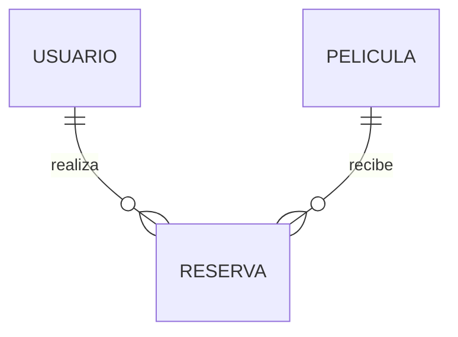

# TP2 — API REST de Reservas de Cine

**Trabajo Práctico Integrador — Taller de Programación 2**
**Grupo 3:** Moises Zavaleta
**Repositorio:** https://github.com/ZAVALETAFORT/TP2-2026-TP-Integrador

## 1. Descripción

API REST para gestionar usuarios, películas y reservas de cine.

Tecnologías:

- JavaScript con ES Modules.
- Node.js y Express.
- Zod para validaciones.
- Sequelize con SQLite.
- Persistencia alternativa mediante arrays JavaScript.

La aplicación utiliza una arquitectura en capas:

**Routes → Controllers → Use Cases → DAO**

El Container construye las dependencias y la DAO Factory selecciona el almacenamiento.

## 2. Dominio

### 2.1. Usuario

Campos:

- `id`
- `nombre`
- `email`
- `passwordHash`
- `rol`

Los roles previstos son `cliente` y `admin`.

### 2.2. Película

Campos:

- `id`
- `titulo`
- `genero`
- `imagenUrl`
- `fechaProyeccion`
- `capacidadTotal`
- `cuposDisponibles`

Los campos `genero` e `imagenUrl` son opcionales.

### 2.3. Reserva

Campos:

- `id`
- `usuarioId`
- `peliculaId`
- `cantidad`
- `estado`

Los estados previstos son `activa` y `cancelada`.

### 2.4. Relaciones

Un usuario puede realizar varias reservas y una película puede recibir reservas de distintos usuarios.

Reserva relaciona las entidades Usuario y Película.



## 3. Reglas de negocio

Implementadas:

- No se permiten emails duplicados.
- Las películas nuevas comienzan con todos sus cupos disponibles.
- No se permite reducir la capacidad por debajo de los lugares ocupados.
- Los errores de validación utilizan Zod.
- Los errores de negocio se representan mediante AppError.
- Se verifica que existan el usuario y la película al reservar.
- Se controla la disponibilidad de cupos.
- Se impiden dos reservas activas del mismo usuario para la misma película.
- Se descuentan cupos al reservar.
- Se devuelven cupos una sola vez al cancelar.
- Se ajustan los cupos al cambiar la cantidad de la reserva.
- Se impide eliminar usuarios o películas con reservas asociadas.

Pendiente:

- Aplicar permisos según el usuario autenticado.

Las reglas de negocio deben permanecer en los Use Cases.

## 4. Arquitectura

```text
index.js              Inicio de Express
config/               Configuración centralizada
connection/           Conexión Sequelize
container/            Inyección de dependencias
dao/                  DAO Memory y DAO Sequelize
dao/models/           Modelos y relaciones SQL
controllers/          Entrada y salida HTTP
routes/               Endpoints y Swagger UI
usecases/             Reglas de negocio
schemas/              Validación Zod
middlewares/          Validaciones y errores
errors/               AppError
events/               Bus y nombres de eventos
alerts/               Listeners
notifications/         Notificador por consola
docs/                  Contrato OpenAPI 3.1
postman/               Pruebas HTTP
```

### DAO Factory

Cada entidad dispone de adaptadores con la misma interfaz:

- **Memory:** arrays de JavaScript, sin base de datos.
- **Sequelize:** almacenamiento en SQLite.

La selección se realiza mediante `PERSISTENCE_TYPE`.

### Container

El Container:

1. Inicializa SQLite cuando corresponde.
2. Selecciona los DAO mediante la Factory.
3. Inyecta los DAO en las factories de casos de uso.
4. Inyecta los casos de uso en los Controllers.
5. Construye y devuelve el Router principal.

Los Controllers no importan los DAO concretos.

## 5. Instalación

### Requisitos

- Node.js 24.
- npm.
- Git.

### Clonar la versión en desarrollo

```bash
git clone --branch develop https://github.com/ZAVALETAFORT/TP2-2026-TP-Integrador.git
cd TP2-2026-TP-Integrador
```

### Instalar dependencias

```bash
npm ci
```

### Iniciar la API

```bash
npm start
```

Para desarrollo con reinicio automático:

```bash
npm run dev
```

No es obligatorio crear un archivo `.env`.

Por defecto, el sistema utiliza SQLite y el puerto `8080`.

Al iniciar, la aplicación crea automáticamente el directorio `data/`, el archivo SQLite si no existe y las tablas correspondientes.

No se requiere instalar SQLite por separado ni ejecutar comandos SQL manuales.

## 6. Configuración

Variables documentadas en `.env.example`:

| Variable           | Valor predeterminado                        | Descripción                                                                                    |
| ------------------ | ------------------------------------------- | ---------------------------------------------------------------------------------------------- |
| `PORT`             | `8080`                                      | Puerto HTTP de la aplicación (8080 en el config default)                                       |
| `NODE_ENV`         | `development`                               | Entorno de ejecución: `development`, `production` o `test`.                                    |
| `PERSISTENCE_TYPE` | `sequelize`                                 | Adaptador de persistencia: `memory` (arrays) o `sequelize` (SQLite).                           |
| `SQLITE_STORAGE`   | `data/cine.sqlite`                          | Ruta del archivo SQLite cuando se utiliza Sequelize; `:memory:` para una base temporal en RAM. |
| `DOCS_ENABLED`     | `true` en desarrollo; `false` en producción | Habilita o deshabilita Swagger UI (`/api-docs`) y el contrato (`/openapi.json`).               |
| `MOCK_ENABLED`     | `true` en desarrollo; `false` en producción | Activa la precarga automática de datos de prueba (`/data/mock.js`)                             |

El archivo `.env` es opcional y permite sobrescribir los valores predeterminados. No se versiona en Git.

**Documentación:** si `DOCS_ENABLED` no está definido, se habilita automáticamente en `development` y se deshabilita en `production`. Un valor explícito `DOCS_ENABLED=true` o `DOCS_ENABLED=false` tiene prioridad sobre `NODE_ENV`. Si se copia `.env.example` a `.env` (`DOCS_ENABLED=true`), la documentación de OpenAPI y Swagger se habilita aunque sea `production`.

### SQLite persistente

```bash
PERSISTENCE_TYPE=sequelize npm start
```

Los datos se almacenan en `data/cine.sqlite`.

### Arrays JavaScript

```bash
PERSISTENCE_TYPE=memory npm start
```

Los datos se almacenan en memoria y desaparecen al detener el proceso.

### SQLite temporal para pruebas

```bash
PERSISTENCE_TYPE=sequelize SQLITE_STORAGE=:memory: npm start
```

Este último modo utiliza SQLite en RAM. No equivale al DAO Memory implementado con arrays.

### Activar o desactivar Swagger

```bash
DOCS_ENABLED=true npm start
DOCS_ENABLED=false npm start
```

La configuración se aplica al iniciar el servidor. Con la documentación deshabilitada, `/api-docs` y `/openapi.json` responden `404`; los endpoints de negocio permanecen activos.

## 7. Endpoints implementados

### Salud

- `GET /health`

### Películas

- `GET /peliculas`
- `GET /peliculas/:id`
- `POST /peliculas`
- `PUT /peliculas/:id`
- `DELETE /peliculas/:id`

### Usuarios

- `GET /usuarios`
- `GET /usuarios/:id`
- `POST /usuarios`
- `PUT /usuarios/:id`
- `DELETE /usuarios/:id`

### Reservas

- `GET /reservas`
- `GET /reservas/:id`
- `POST /reservas`
- `PUT /reservas/:id`
- `DELETE /reservas/:id`

Las rutas permiten probar los CRUD y sus validaciones. La autorización por roles se incorporará en una fase posterior. La especificación completa de los endpoints está en `/api-docs`.

## 8. Validaciones y errores

Se utiliza Zod para validar entradas y un middleware de errores centralizado.

Ejemplo de respuesta:

```json
{
  "error": {
    "code": "EMAIL_DUPLICATED",
    "message": "El email ya está registrado"
  }
}
```

Se utilizan los códigos HTTP correspondientes a cada operación, incluidos `200`, `201`, `204`, `400`, `404`, `409` y `500`.

## 9. Eventos

Se implementó el evento de dominio `reserva.creada` mediante `EventEmitter`.

Después de guardar correctamente una reserva, el caso de uso emite el evento. Un listener independiente utiliza `consoleNotifier` para mostrar una notificación en la consola del servidor.

El listener captura los errores del notificador para que un fallo al notificar no afecte una reserva ya confirmada.

## 10. Autenticación y permisos

Pendiente de implementación:

- Registro público.
- Login.
- Contraseñas con bcrypt.
- JWT.
- Roles `cliente` y `admin`.
- Restricción de acceso a reservas propias.
- Administración de usuarios y películas.
- Inicialización segura de un administrador.

No se publicarán secretos ni contraseñas en Git.

## 11. Datos iniciales

`data/mock.js` precarga automáticamente datos de prueba en una base vacía:

- Usuarios.
- Películas con fechas futuras.
- Reservas: 40 activas y 8 canceladas.

Incluye salas completas, cupos disponibles, cancelaciones
y reservas de distintos usuarios.

La precarga utiliza los casos de uso existentes y no modifica
bases que ya contengan registros.

Se controla con `MOCK_ENABLED=true` o `MOCK_ENABLED=false` en el .env.

## 12. Documentación

Se integró OpenAPI 3.1 con Swagger UI en:

- **Swagger UI:** `http://localhost:8080/api-docs/`
- **Contrato OpenAPI:** `http://localhost:8080/openapi.json`

Documenta las 16 operaciones de Salud, Usuarios, Películas y Reservas con parámetros, cuerpos de petición, ejemplos, códigos HTTP, errores y schemas de respuesta reutilizables mediante `$ref`.

Los schemas Zod de entrada se reutilizan para generar la documentación. Swagger UI permite utilizar _Try it out_ sobre las rutas reales de la API. Las rutas de documentación se montan solamente si `DOCS_ENABLED` está habilitado.

La comprobación funcional completa de _Try it out_ en ambos modos de persistencia continúa pendiente de QA.

## 13. Pruebas

Pruebas completadas durante el desarrollo:

- Validación de sintaxis.
- CRUD de Películas con DAO Memory y Sequelize.
- CRUD de Usuarios con DAO Memory y Sequelize.
- Comparación de respuestas entre ambos DAO.
- Persistencia SQLite entre procesos.
- Inicialización de las tres tablas.
- Construcción del Container.
- Inyección de Controllers.
- Pruebas HTTP de creación, consulta y errores.
- Respuesta HTTP 409 para emails duplicados.
- Pruebas de Reservas en ambos modos, con solicitudes registradas en consola.
- Emisión del evento `reserva.creada` en Memory y Sequelize.
- Comprobación de que un fallo simulado del notificador es capturado por el listener.
- Comprobación de OpenAPI 3.1, sus 16 operaciones y referencias de schemas.
- Comprobaciones HTTP 200 de Swagger y OpenAPI habilitados y HTTP 404 cuando se deshabilitan explícitamente.

Pruebas pendientes:

- Instalación desde un clon limpio.
- Validación HTTP completa de estados y cupos en ambas persistencias.
- Pruebas de concurrencia y transacciones con peticiones simultáneas.
- Autenticación y autorización, cuando se implementen.
- Prueba funcional integral de _Try it out_ desde Swagger UI en ambos modos.
- «Verificación del comportamiento por defecto según NODE_ENV», hasta que se ejecute esa prueba.

## 14. Archivos excluidos del repositorio

No deben subirse:

- `.env`
- `node_modules/`
- Archivos `.sqlite`
- Archivos auxiliares de SQLite
- Secretos y credenciales

El archivo `.env.example` sí debe versionarse.

## 15. Estado del proyecto

**En desarrollo.**

Completados: modelos y relaciones, CRUD de Películas, Usuarios y Reservas, persistencia Memory/Sequelize, DAO Factory, Container, eventos y documentación Swagger/OpenAPI integrada.

Pendientes: QA funcional completo, autenticación y permisos
previstos en el README.

La rama de trabajo es `develop`. Se realizan integraciones incrementales a `main` después de validar cada fase
