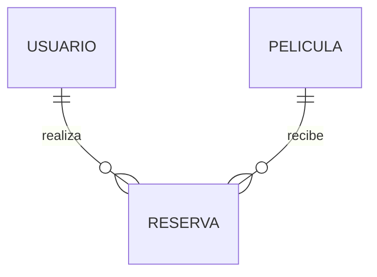

# TP2 — API REST de Reservas de Cine

**Trabajo Práctico Integrador — Taller de Programación 2**  
**Grupo 3:** Moises Zavaleta  
**Repositorio:** https://github.com/ZAVALETAFORT/TP2-2026-TP-Integrador

## 1. Descripción

API REST para gestionar usuarios, películas y reservas de cine.

Tecnologías:

- JavaScript con ES Modules.
- Node.js y Express.
- Zod para validaciones.
- Sequelize con SQLite.
- Persistencia alternativa mediante arrays JavaScript.

La aplicación utiliza una arquitectura en capas:

**Routes → Controllers → Use Cases → DAO**

El Container construye las dependencias y la DAO Factory selecciona el almacenamiento.

## 2. Dominio

### 2.1. Usuario

Campos:

- `id`
- `nombre`
- `email`
- `passwordHash`
- `rol`

Los roles previstos son `cliente` y `admin`.

### 2.2. Película

Campos:

- `id`
- `titulo`
- `genero`
- `imagenUrl`
- `fechaProyeccion`
- `capacidadTotal`
- `cuposDisponibles`

Los campos `genero` e `imagenUrl` son opcionales.

### 2.3. Reserva

Campos:

- `id`
- `usuarioId`
- `peliculaId`
- `cantidad`
- `estado`

Los estados previstos son `activa` y `cancelada`.

### 2.4. Relaciones

Un usuario puede realizar varias reservas y una película puede recibir reservas de distintos usuarios.

Reserva relaciona las entidades Usuario y Película.



## 3. Reglas de negocio

Implementadas:

- No se permiten emails duplicados.
- Las películas nuevas comienzan con todos sus cupos disponibles.
- No se permite reducir la capacidad por debajo de los lugares ocupados.
- Los errores de validación utilizan Zod.
- Los errores de negocio se representan mediante AppError.

Pendientes de integrar con Reservas:

- Verificar que existan el usuario y la película.
- Controlar la disponibilidad de cupos.
- Impedir dos reservas activas del mismo usuario para la misma película.
- Descontar cupos al reservar.
- Devolver cupos una sola vez al cancelar.
- Ajustar cupos al cambiar la cantidad.
- Impedir eliminar usuarios o películas con reservas asociadas.
- Aplicar permisos según el usuario autenticado.

Las reglas de negocio deben permanecer en los Use Cases.

## 4. Arquitectura

```text
index.js              Inicio de Express
config/               Configuración centralizada
connection/           Conexión Sequelize
container/            Inyección de dependencias
dao/                  DAO Memory y DAO Sequelize
dao/models/           Modelos y relaciones SQL
controllers/          Entrada y salida HTTP
routes/               Endpoints
usecases/             Reglas de negocio
schemas/              Validación Zod
middlewares/          Validaciones y errores
errors/               AppError
postman/              Pruebas HTTP
```

### DAO Factory

Cada entidad dispone de adaptadores con la misma interfaz:

- **Memory:** arrays de JavaScript, sin base de datos.
- **Sequelize:** almacenamiento en SQLite.

La selección se realiza mediante `PERSISTENCE_TYPE`.

### Container

El Container:

1. Inicializa SQLite cuando corresponde.
2. Selecciona los DAO mediante la Factory.
3. Inyecta los DAO en las factories de casos de uso.
4. Inyecta los casos de uso en los Controllers.
5. Construye y devuelve el Router principal.

Los Controllers no importan los DAO concretos.

## 5. Instalación

### Requisitos

- Node.js 24.
- npm.
- Git.

### Clonar la versión en desarrollo

```bash
git clone --branch develop https://github.com/ZAVALETAFORT/TP2-2026-TP-Integrador.git
cd TP2-2026-TP-Integrador
```

### Instalar dependencias

```bash
npm ci
```

### Iniciar la API

```bash
npm start
```

Para desarrollo con reinicio automático:

```bash
npm run dev
```

No es obligatorio crear un archivo `.env`.

Por defecto, el sistema utiliza SQLite y el puerto `8080`.

Al iniciar, la aplicación crea automáticamente el directorio `data/`, el archivo SQLite si no existe y las tablas correspondientes.

No se requiere instalar SQLite por separado ni ejecutar comandos SQL manuales.

## 6. Configuración

Valores predeterminados:

| Variable | Valor |
|---|---|
| `PORT` | `8080` |
| `PERSISTENCE_TYPE` | `sequelize` |
| `SQLITE_STORAGE` | `data/cine.sqlite` |

El archivo `.env.example` documenta estas variables.

El archivo `.env` es opcional y permite sobrescribir los valores predeterminados.

### SQLite persistente

```bash
PERSISTENCE_TYPE=sequelize npm start
```

Los datos se almacenan en `data/cine.sqlite`.

### Arrays JavaScript

```bash
PERSISTENCE_TYPE=memory npm start
```

Los datos se almacenan en memoria y desaparecen al detener el proceso.

### SQLite temporal para pruebas

```bash
PERSISTENCE_TYPE=sequelize SQLITE_STORAGE=:memory: npm start
```

Este último modo utiliza SQLite en RAM. No equivale al DAO Memory implementado con arrays.

## 7. Endpoints implementados

### Salud

- `GET /health`

### Películas

- `GET /peliculas`
- `GET /peliculas/:id`
- `POST /peliculas`
- `PUT /peliculas/:id`
- `DELETE /peliculas/:id`

### Usuarios

- `GET /usuarios`
- `GET /usuarios/:id`
- `POST /usuarios`
- `PUT /usuarios/:id`
- `DELETE /usuarios/:id`

Actualmente las rutas permiten probar los CRUD y sus validaciones. La autorización por roles se incorporará en una fase posterior.

## 8. Validaciones y errores

Se utiliza Zod para validar entradas y un middleware de errores centralizado.

Ejemplo de respuesta:

```json
{
  "error": {
    "code": "EMAIL_DUPLICATED",
    "message": "El email ya está registrado"
  }
}
```

Se utilizan los códigos HTTP correspondientes a cada operación, incluidos `200`, `201`, `204`, `400`, `404`, `409` y `500`.

## 9. Eventos

Se implementará un evento de dominio mediante EventEmitter:

`reserva.creada`

Un listener independiente enviará una notificación a consola mediante un notificador.

Los errores del listener no deben impedir confirmar una reserva ya guardada.

## 10. Autenticación y permisos

Pendiente de implementación:

- Registro público.
- Login.
- Contraseñas con bcrypt.
- JWT.
- Roles `cliente` y `admin`.
- Restricción de acceso a reservas propias.
- Administración de usuarios y películas.
- Inicialización segura de un administrador.

No se publicarán secretos ni contraseñas en Git.

## 11. Datos iniciales

Está prevista una precarga de datos de ejemplo mediante `mock.js`.

La precarga deberá ser segura e idempotente, evitando duplicaciones o sobrescritura de datos al reiniciar.

Todavía no está implementada.

## 12. Documentación

Se publicará documentación OpenAPI 3 mediante Swagger UI en:

`/api-docs`

La documentación incluirá los endpoints, parámetros, ejemplos, respuestas y errores.

**Pendiente de implementación.**

## 13. Pruebas

Pruebas completadas durante el desarrollo:

- Validación de sintaxis.
- CRUD de Películas con DAO Memory y Sequelize.
- CRUD de Usuarios con DAO Memory y Sequelize.
- Comparación de respuestas entre ambos DAO.
- Persistencia SQLite entre procesos.
- Inicialización de las tres tablas.
- Construcción del Container.
- Inyección de Controllers.
- Pruebas HTTP de creación, consulta y errores.
- Respuesta HTTP 409 para emails duplicados.

Pruebas pendientes:

- Instalación desde un clon limpio.
- Reservas y control de cupos.
- Concurrencia y transacciones.
- Autenticación y autorización.
- Eventos.
- Swagger.

## 14. Archivos excluidos del repositorio

No deben subirse:

- `.env`
- `node_modules/`
- Archivos `.sqlite`
- Archivos auxiliares de SQLite
- Secretos y credenciales

El archivo `.env.example` sí debe versionarse.

## 15. Estado del proyecto

**En desarrollo.**

Completados: modelos, persistencia básica de Películas y Usuarios, DAO Factory, Container e integración HTTP.

Pendientes: Reservas, Eventos, Autenticación, Swagger y QA final desde clon limpio.

La rama de trabajo es `develop`. La integración final a `main` se realizará después de completar las pruebas.