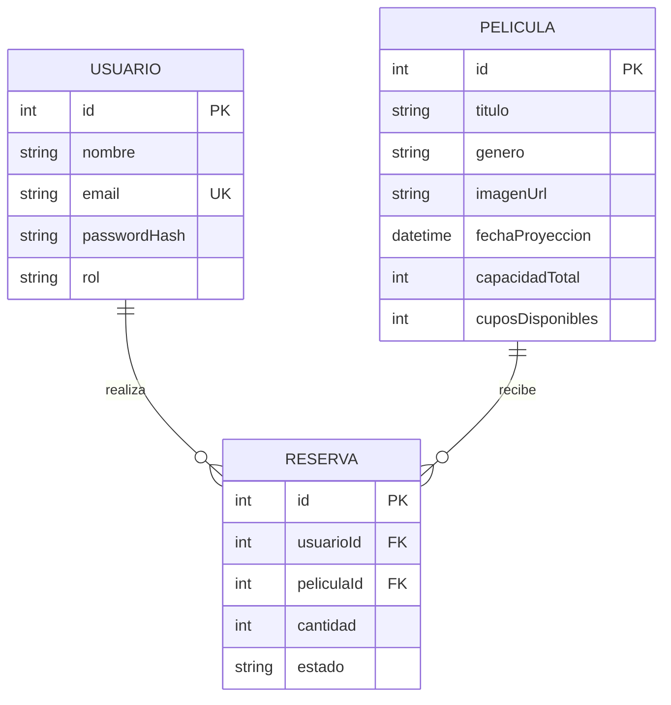
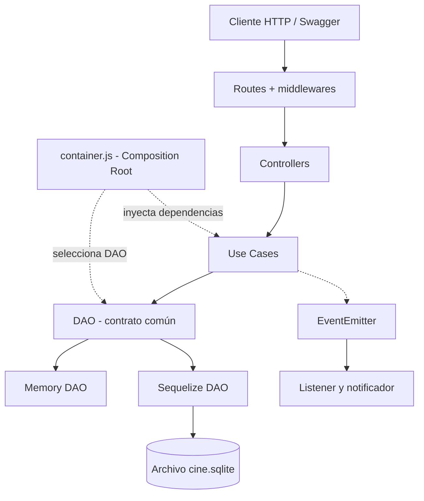

# TP2 — API REST de Reservas de Cine

**Trabajo Práctico Integrador — Taller de Programación 2**
**Grupo 3:** Moises Zavaleta
**Repositorio:** [TP2-2026-TP-Integrador](https://github.com/ZAVALETAFORT/TP2-2026-TP-Integrador)

## Proyecto

API REST para gestionar **usuarios, películas y reservas de cine**. Los clientes podrán registrarse, iniciar sesión, consultar la cartelera y reservar lugares disponibles. Los admins podrán gestionar el catálogo y las reservas.

La API se implementará con Node.js y Express, aplicando la **arquitectura en capas**: rutas, controladores, casos de uso y DAO. Funciona con una base SQLite local o en RAM, sin modificar las reglas de negocio.

## 1. Dominio

### 1.1. Funcionamiento del sistema

1. El admin carga películas con sus datos, fecha de proyección y cantidad de lugares.
2. El cliente consulta la cartelera, se registra e inicia sesión.
3. El cliente selecciona una película y solicita una cantidad de lugares.
4. La API comprueba la disponibilidad, registra la reserva y descuenta los cupos.
5. El cliente puede consultar o cancelar su reserva. Al cancelarla, los lugares vuelven a estar disponibles.

Cada película tendrá una fecha de proyección y una cantidad de lugares asociadas. El sistema administrará esas reservas directamente, sin otras entidades.

### 1.2. Entidades


| Entidad      | Descripción                                          | Campos principales                                                                             |
| -------------- | ------------------------------------------------------- | ------------------------------------------------------------------------------------------------ |
| **Usuario**  | Persona registrada, con rol `cliente` o `admin`.      | `id`, `nombre`, `email`, `passwordHash`, `rol`                                                 |
| **Pelicula** | Película del catálogo y sus lugares disponibles.    | `id`, `titulo`, `genero`, `imagenUrl`, `fechaProyeccion`, `capacidadTotal`, `cuposDisponibles` |
| **Reserva**  | Lugares reservados por un usuario para una película. | `id`, `usuarioId`, `peliculaId`, `cantidad`, `estado`                                          |

La entidad **Reserva** vincula a las otras dos entidades y registra si la reserva está `activa` o `cancelada`.

### 1.3. Relaciones

- **Usuario 1:N Reserva:** un usuario puede realizar varias reservas.
- **Pelicula 1:N Reserva:** una película puede tener varias reservas.
- **Usuario N:N Pelicula:** la relación se resuelve mediante **Reserva**, que funciona como entidad intermedia.



### 1.4. Reglas de negocio

- El email de un usuario debe ser único.
- Para reservar, el usuario y la película deben existir, la cantidad debe ser positiva y debe haber cupos suficientes para la peli.
- Crear una reserva **descuenta cupos**; cancelarla o eliminar una reserva activa **devuelve los cupos**. Modificar la cantidad ajusta la diferencia.
- Un cliente solo puede gestionar sus propias reservas; las operaciones administrativas requieren el rol `admin`.

Estas reglas se aplicarán en los **casos de uso**, no en los controladores.

## 2. Implementación del sistema

### 2.1. Servidor y estructura

El servidor utilizará **JavaScript con ES Modules, Node.js y Express**. El archivo `index.js` iniciará Express, instalará los middlewares generales y montará el router generado por el contenedor.

Se organizará en las carpetas de la cursada:

```text
index.js
config/          # Variables de entorno
container/       # Ensamblado de dependencias
routes/          # Endpoints HTTP
controllers/     # Solicitudes y respuestas HTTP
usecases/        # Reglas de negocio
dao/             # Adaptadores en memoria y Sequelize
schemas/         # Esquemas Zod
middlewares/     # Validación, autenticación y errores
errors/          # AppError
```

Los módulos de conexión SQL, eventos y seguridad se incorporarán en archivos separados según su responsabilidad.

### 2.2. Entidades y CRUD

**Usuario, Pelicula y Reserva** tendrán CRUD completo: **listar, obtener por ID, crear, actualizar y eliminar** mediante métodos HTTP `GET`, `POST`, `PUT` y `DELETE`.

Para los clientes, la cancelación cambiará el estado de la reserva a `cancelada`; la eliminación será una operación administrativa. Las relaciones entre entidades se respetarán al actualizar o eliminar registros.

El registro e inicio de sesión se ofrecerán mediante rutas de autenticación independientes del CRUD de usuarios.

### 2.3. Validación y errores

Los datos recibidos por `body`, `params` y `query` se validarán con **Zod** mediante middlewares reutilizables. Los errores de negocio utilizarán **AppError** y se procesarán con un único `errorHandler`, además de `notFound` para rutas inexistentes.

Las respuestas utilizarán códigos HTTP adecuados: `200`, `201`, `204`, `400`, `404`, `409` y `500`; también `401` y `403` para autenticación y permisos.

### 2.4. Persistencia intercambiable

Cada entidad tendrá dos DAO con **los mismos métodos y formato de respuesta**:


| Configuración               | Persistencia       | Descripción                           |
| ------------------------------ | -------------------- | ---------------------------------------- |
| `PERSISTENCE_TYPE=memory`    | Arrays js en RAM   | Data temporal durante la ejecución. |
| `PERSISTENCE_TYPE=sequelize` | Sequelize + SQLite | Persistentes en `data/cine.sqlite`.    |

La selección se realizará desde una **DAO Factory**. Los DAO devolverán objetos JavaScript planos, no instancias de Sequelize.

SQLite utilizará un archivo local: **no será necesario instalar un servidor SQL**. Si el archivo se elimina con la aplicación detenida, las tablas se crearán nuevamente al iniciar. Un reinicio normal conservará los datos. La conexión quedará aislada para permitir otro motor compatible con Sequelize en el futuro.

### 2.5. Inyección de dependencias y arquitectura

La arquitectura seguirá el recorrido **Routes → Controllers → Use Cases → DAO**.

- **Routes:** definen los endpoints y ejecutan middlewares.
- **Controllers:** reciben la petición HTTP y llaman al caso de uso.
- **Use Cases:** contienen las reglas del negocio.
- **DAO:** consultan y modifican los datos, independientemente de la tecnología utilizada.

El **Composition Root** (`container/container.js`) seleccionará los DAO y los inyectará mediante las factories `makeXxxUseCases`. Los casos de uso no importarán DAO concretos y los controladores NO accederán directamente a la base de datos.



**Lectura del diagrama:** la petición avanza desde la ruta hasta el DAO; la factory permite cambiar el almacenamiento. Los eventos notifican acciones sin mezclar esa responsabilidad con la reserva.

### 2.6. Eventos

Se utilizará **EventEmitter**, con el bus creado en el contenedor y un listener separado del caso de uso.

- `reserva.creada`: registra una notificación cuando se confirma una reserva.
- `pelicula.sinCupos`: avisa cuando se agotan los lugares de una película.

Los notificadores utilizarán una interfaz común, con salida a **consola o archivo**. Un error del listener no deberá interrumpir una reserva confirmada.

### 2.7. Documentación de la API [Pendiente para ver en clase]

[Pendiente para ver en clase]

### 2.8. Instalación y configuración

La aplicación se ejecutará con Node.js y npm. Una vez implementados los scripts y las dependencias, el procedimiento será:

```bash
npm ci
cp .env.example .env (copiar el env)
npm run dev
```

Las variables principales serán `PORT`, `PERSISTENCE_TYPE`, `SQLITE_STORAGE`, `JWT_SECRET` y `NOTIFIER_TYPE`. El archivo `.env.example` documentará su configuración; `.env` y los archivos `.sqlite` permanecerán fuera de Git.

Para cambiar de persistencia a SQLite o en memoria se cambia en `PERSISTENCE_TYPE` y se reiniciará la aplicación. [documentar en swagger]

## 3. Funcionalidades complementarias

Además del CRUD básico, el sistema incorporará de forma sencilla las funcionalidades trabajadas en clase y previstas como opcionales del integrador:

- **Seguridad:** registro, login, contraseñas hasheadas con bcrypt y permisos mediante JWT (`cliente` / `admin`).
- **Consultas:** filtros, ordenamiento y paginación en los listados.
- **Relaciones y transacción:** Reserva como tabla intermedia N:N; guardar la reserva y descontar cupos de forma atómica.
- **Eventos:** dos eventos con notificación por consola o archivo.
- **Pruebas automatizadas:** tests de casos de uso con DAO en memoria.
- **Docker:** Dockerfile o Compose para ejecutar la API con su archivo SQLite.

El catálogo también podrá cargarse desde una API pública de películas mediante `fetch`, guardando los datos localmente.

## 4. Pruebas funcionales previstas

Al finalizar el alcance debe cumplir:

- [ ]  Un usuario puede registrarse, iniciar sesión y obtener un token JWT.
- [ ]  Cualquier persona puede consultar las películas disponibles.
- [ ]  Un admin puede crear, modificar y eliminar películas.
- [ ]  Un cliente autenticado puede reservar lugares disponibles.
- [ ]  La reserva descuenta los cupos y no permite reservar más lugares de los existentes.
- [ ]  El cliente puede consultar y cancelar sus reservas; la cancelación restituye los lugares.
- [ ]  Un cliente no puede administrar películas ni modificar reservas de otros usuarios.
- [ ]  Los CRUD de las tres entidades funcionan en los modos `memory` y `sequelize` con respuestas equivalentes.
- [ ]  El archivo SQLite conserva los datos entre reinicios y puede recrearse vacío si se elimina con la API detenida.
- [ ]  Los eventos se notifican sin afectar las operaciones y Swagger permite probar los endpoints.


**Estado:** Todavia estoy en diseño, nos faltan ver otras clases
