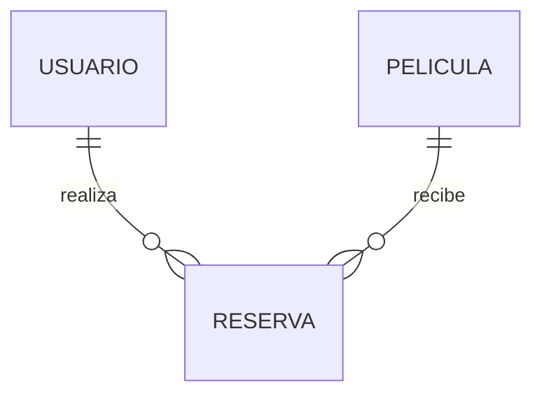
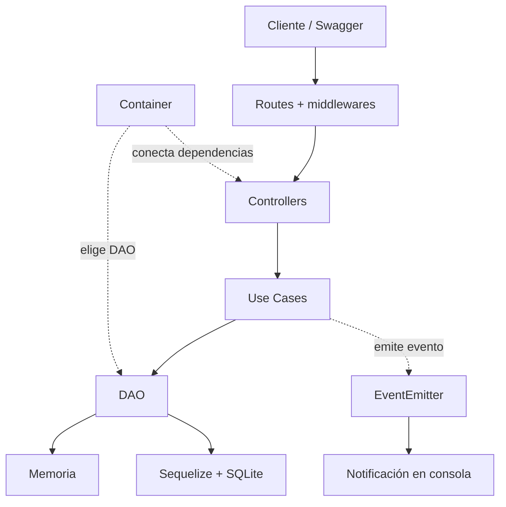

# TP2 — API REST de Reservas de Cine

**Trabajo Práctico Integrador — Taller de Programación 2**
**Grupo 3:** Moises Zavaleta
**Repo:** https://github.com/ZAVALETAFORT/TP2-2026-TP-Integrador

## Proyecto

API REST para gestionar **usuarios, películas y reservas de cine**. Los clientes podrán registrarse, iniciar sesión, consultar la cartelera y reservar lugares disponibles. Los admins podrán gestionar las pelis, los usuarios y las reservas.

Voy a usar **Node.js, Express y JavaScript**. Los datos se guardarán en memoria o en **SQLite**, según la configuración.

## 1. Dominio

### 1.1. ¿Cómo funciona?

1. El admin carga una película, su fecha de proyección y la cantidad de lugares.
2. El cliente consulta la cartelera, se registra e inicia sesión.
3. Elige una peli e indica cuántos lugares quiere reservar.
4. La API verifica los cupos, guarda la reserva y descuenta los lugares.
5. El cliente puede consultar o cancelar su reserva. Si cancela, se devuelven los cupos.

### 1.2. Entidades


| Entidad      | Para qué sirve                   | Campos                                                                                         |
| -------------- | ----------------------------------- | ------------------------------------------------------------------------------------------------ |
| **Usuario**  | Cliente o admin del sistema.      | `id`, `nombre`, `email`, `passwordHash`, `rol`                                                 |
| **Pelicula** | Peli de la cartelera y sus cupos. | `id`, `titulo`, `genero`, `imagenUrl`, `fechaProyeccion`, `capacidadTotal`, `cuposDisponibles` |
| **Reserva**  | Une un usuario con una película. | `id`, `usuarioId`, `peliculaId`, `cantidad`, `estado`                                          |

`genero` e `imagenUrl` serán opcionales. El estado de la reserva será `activa` o `cancelada`.

### 1.3. Relaciones



Un usuario puede tener varias reservas y una película puede recibir varias reservas. **Reserva** es la entidad que relaciona a las otras dos.

### 1.4. Reglas de negocio

- Un mismo email no puede registrarse dos veces.
- Solo se puede reservar si existen el usuario y la película, la cantidad es mayor a cero y hay cupos suficientes.
- Un usuario no puede tener dos reservas **activas** para la misma peli.
- Crear una reserva descuenta cupos; cancelarla devuelve los cupos **una sola vez**. Si se modifica la cantidad, se ajusta la diferencia.
- No se pueden eliminar usuarios ni películas que tengan reservas.
- Un cliente solo puede ver y gestionar **sus propias reservas**. Los admins pueden gestionar usuarios, pelis y reservas.

Estas reglas van en los **Use Cases**, no en los Controllers.

## 2. Implementación del sistema

### 2.1. Arquitectura

Patron: **Routes → Controllers → Use Cases → DAO**.

- **Routes:** definen los endpoints y usan middlewares.
- **Controllers:** reciben la petición HTTP y devuelven la respuesta.
- **Use Cases:** aplican las reglas de negocio.
- **DAO:** guardan y buscan los datos.

El **Container** (`container/container.js`) conecta las capas y elige qué DAO usar. Así podemos cambiar entre memoria y SQLite sin cambiar el resto del código.



Se puede usar como persistencia **RAM o SQLite**

### 2.2. Servidor y carpetas

Uso de **JavaScript con ES Modules, Node.js y Express**. `index.js` solo configurará e iniciará el servidor con el router que entrega el Container.

```text
index.js        # Inicio de la API
config/         # Variables de entorno
container/      # Conecta las capas
routes/         # Endpoints
controllers/    # Entrada y salida HTTP
usecases/       # Reglas de negocio
data-access/    # Memoria y Sequelize (DAO)
schemas/        # Validaciones Zod
middlewares/    # Validación, login y errores
errors/         # AppError
```

Los archivos de eventos, conexión y seguridad se agregarán cuando hagan falta, sin crear carpetas vacías de entrada.

### 2.3. CRUD y login

**Usuario, Pelicula y Reserva** tendrán CRUD: listar, buscar por ID, crear, actualizar y eliminar (`GET`, `POST`, `PUT`, `DELETE`).

Para el cliente, **cancelar** una reserva cambia su estado a `cancelada`; borrarla queda reservado al admin. El registro y el login tendrán rutas separadas.

Uso de **bcrypt** para guardar contraseñas como hash y **JWT** para identificar al usuario. Habrá dos roles: `cliente` y `admin`. El registro público siempre crea clientes; el admin inicial se configurará al arrancar la API.

### 2.4. Validaciones y errores

Uso de **Zod** para validar `body`, `params` y `query`. Los errores de negocio se manejarán con `AppError`, un `errorHandler` general y `notFound` para rutas inexistentes.

La API responderá con códigos HTTP adecuados (`200`, `201`, `204`, `400`, `401`, `403`, `404`, `409` y `500`) y errores con un formato consistente.

### 2.5. Persistencia

Cada entidad tendrá dos DAO con **los mismos métodos y respuestas**:


| Configuración               | Dónde guarda los datos                       |
| ------------------------------ | ----------------------------------------------- |
| `PERSISTENCE_TYPE=memory`    | Arrays de js en RAM; se pierden al reiniciar. |
| `PERSISTENCE_TYPE=sequelize` | SQLite en `data/cine.sqlite`;                 |

Para SQLlite se va crear un mock.js con datos de precarga (users, pelis, reservas)

### 2.6. Eventos

Uso de **EventEmitter** para un evento sencillo:

- `reserva.creada`: cuando se confirma una reserva, un listener muestra una notificación en consola.

Si falla la notificación, la reserva debe seguir confirmada. Por ahora no necesitamos enviar emails ni guardar notificaciones en archivos.

### 2.7. Documentación

La API se documentará con **OpenAPI 3 y Swagger UI** en `/api-docs`, incluyendo endpoints, datos de entrada, respuestas y errores. Desde ahí podremos probar tanto el modo memoria como SQLite. [Esto lo veo en la prox clase]

### 2.8. Instalación

Cuando el código esté implementado:

```bash
npm ci
cp .env.example .env
npm run dev
```

El `.env.example` mostrará las variables necesarias: `PORT`, `PERSISTENCE_TYPE`, `SQLITE_STORAGE`, `JWT_SECRET`, `ADMIN_EMAIL` y `ADMIN_PASSWORD`. No subiremos al repo `.env`, `node_modules` ni archivos `.sqlite`.

Para cambiar entre memoria y SQLite, editamos `PERSISTENCE_TYPE` en `.env` y reiniciamos la API.

## 3. Pruebas funcionales previstas

- [ ]  La API arranca y Swagger abre en `/api-docs`.
- [ ]  Un cliente se registra, inicia sesión y obtiene un JWT.
- [ ]  Cualquiera puede consultar la cartelera; solo un admin puede modificar las pelis.
- [ ]  Funcionan los CRUD de usuarios, películas y reservas.
- [ ]  No se permiten emails duplicados, cantidades inválidas ni reservas sin cupos.
- [ ]  Un usuario no puede tener dos reservas activas para la misma peli.
- [ ]  Crear una reserva descuenta cupos; cancelarla los devuelve una sola vez.
- [ ]  Un cliente no puede gestionar reservas ajenas.
- [ ]  La API responde de forma equivalente usando `memory` o `sequelize`.
- [ ]  SQLite conserva los datos al reiniciar.
- [ ]  El evento `reserva.creada` muestra la notificación sin afectar la reserva.

**Estado:** en diseño. El desarrollo se hará paso a paso sobre la rama `develop`.
